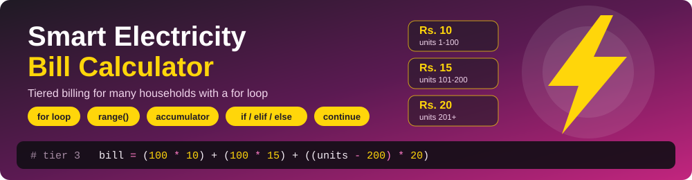
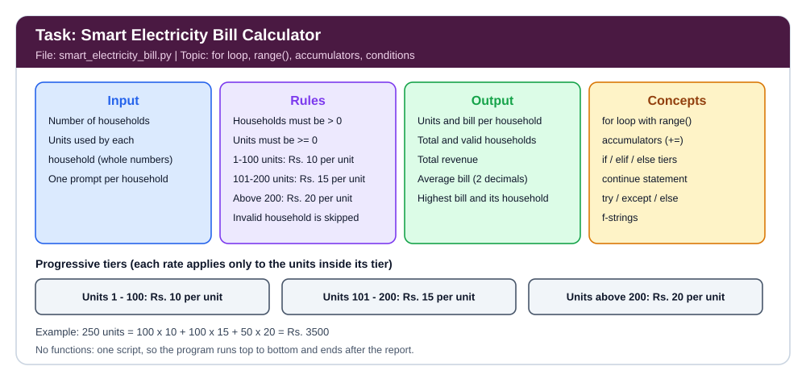
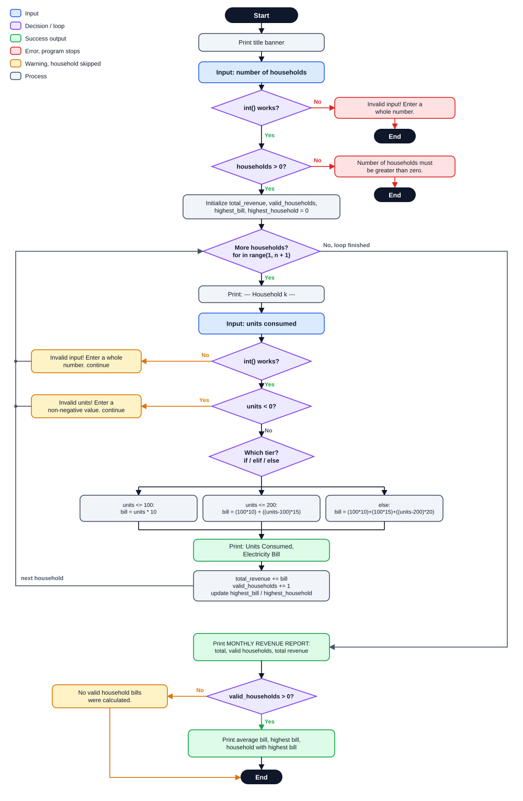
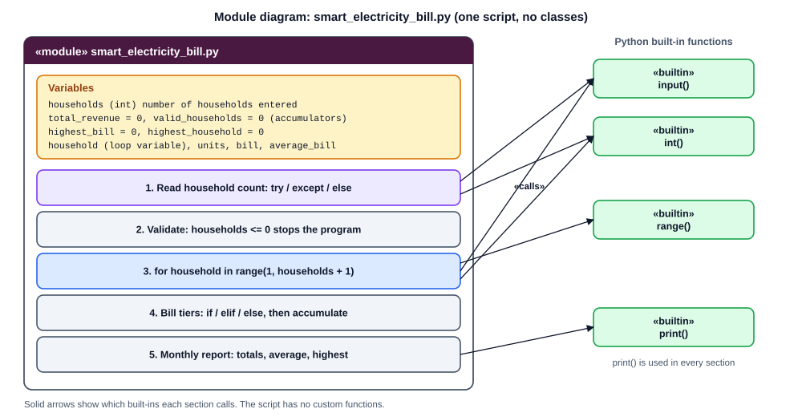

<p align="center"></p>

## 1. Project Overview

> **Live demo (no install needed):** [https://syedamaheen05.github.io/python-loops-electricity-bill-calculator/](https://syedamaheen05.github.io/python-loops-electricity-bill-calculator/)
> Enter households and units in your browser. The page prints the same messages as the Python program. See [How to Run](#6-how-to-run) for how the demo is hosted.

A Python program that calculates monthly electricity bills for many households. A `for` loop with `range()` handles each household, `if` / `elif` / `else` picks the billing tier, and an accumulator adds up the revenue. The rates are fictional and for practice only.

| Task | File | Topic |
|---|---|---|
| Smart Electricity Bill Calculator | `smart_electricity_bill.py` | `for` loop, `range()`, accumulators, conditional statements inside a loop |
| Live demo (browser version) | `index.html` | Same rules and messages with a form-based interface |



## 2. Folder Structure

```text
python-loops-electricity-bill-calculator/
├── smart_electricity_bill.py
├── index.html
├── README.md
└── assets/
    ├── banner.svg
    ├── overview.svg
    ├── electricity_flow.svg
    └── uml_diagram.svg
```

## 3. Task: Smart Electricity Bill Calculator

### Summary

The program asks how many households need a bill, then reads the units used by each household inside a `for household in range(1, households + 1)` loop. Each valid household gets a bill from three progressive tiers. The program adds every valid bill to `total_revenue`, tracks the highest bill, and prints a monthly revenue report with the average bill.

### Rules

- Ask for the number of households; it must be a whole number greater than zero.
- Ask for the units used by each household; units must be a whole number that is not negative.
- Apply the rates progressively. Each rate covers only the units inside its tier.
- Skip a household with invalid units and continue with the next one.
- Show the units and bill for every valid household.
- Show the combined revenue collected from all valid households.

| Units consumed | Rate |
|---|---:|
| First 100 units | Rs. 10 per unit |
| Units 101 to 200 | Rs. 15 per unit |
| Units above 200 | Rs. 20 per unit |

| Units | Calculation | Bill |
|---:|---|---:|
| 80 | 80 x 10 | Rs. 800 |
| 150 | 100 x 10 + 50 x 15 | Rs. 1750 |
| 250 | 100 x 10 + 100 x 15 + 50 x 20 | Rs. 3500 |

### Program Flow



### Code Methods Description

The program is one script with no custom functions, so this table lists its sections.

| Section | Purpose |
|---|---|
| `try` / `except` / `else` around `int(input(...))` | Reads the household count and rejects text, decimals and empty input |
| `if households <= 0` | Stops the program when the count is zero or negative |
| Variable initialization | Sets `total_revenue`, `valid_households`, `highest_bill` and `highest_household` to `0` |
| `for household in range(1, households + 1)` | Repeats the billing steps once per household |
| `try` / `except` around the units input | Rejects non-numeric units and skips the household with `continue` |
| `if units < 0` | Rejects negative units and skips the household with `continue` |
| `if` / `elif` / `else` tiers | Chooses the bill formula for up to 100, up to 200, or above 200 units |
| Display lines inside the loop | Prints `Units Consumed` and `Electricity Bill` |
| `total_revenue += bill`, `valid_households += 1` | Accumulators for revenue and the number of valid households |
| `if valid_households == 1 or bill > highest_bill` | Keeps the highest bill and the household that has it |
| Monthly revenue report | Prints total households, valid households and total revenue |
| `if valid_households > 0` | Prints the average (2 decimals), highest bill and its household, or a "no valid bills" message |

### Input Validation

| Input | Rule | Message shown |
|---|---|---|
| Number of households | Whole number | `Invalid input! Please enter a whole number.` (program ends) |
| Number of households | Greater than zero | `Number of households must be greater than zero.` (program ends) |
| Units consumed | Whole number | `Invalid input! Please enter a whole number.` (household skipped) |
| Units consumed | Not negative | `Invalid units! Please enter a non-negative value.` (household skipped) |

### Expected Results

- Every valid household prints its units and bill. The first 100 units cost Rs. 10 each, units 101 to 200 cost Rs. 15 each, and units above 200 cost Rs. 20 each.
- A skipped household prints one error message and is left out of the revenue, the average and the highest bill. It still counts in `Total Households`.
- The report shows total households, valid households and total revenue.
- When at least one bill is valid, the report also shows the average bill, the highest bill and the household that has it. When two bills tie, the earlier household is reported.
- When no bill is valid, the report shows `No valid household bills were calculated.`
- Nothing is saved: the program ends after the report.

## 4. UML Diagram

I chose a **module diagram** because the program is one procedural script with no classes, so it is clearest to show its variables, its five sections and the built-in functions each section calls.



## 5. Concepts and Techniques Used

- `for` loop with `range(1, households + 1)`
- Accumulators (`total_revenue += bill`, `valid_households += 1`)
- Conditional statements: `if`, `elif`, `else`
- Conditions inside a loop
- `continue` to skip invalid households
- `try` / `except` / `else` with `int()`
- Input validation with clear messages
- Progressive (tiered) calculation
- Tracking a maximum value and its position
- Average calculation and formatted output (`:.2f`)
- f-strings

## 6. How to Run

**Requirements:** Python 3 (tested with Python 3.12.3). No extra libraries.

```bash
git clone https://github.com/Syedamaheen05/python-loops-electricity-bill-calculator.git
cd python-loops-electricity-bill-calculator
```

Run the program with whichever command works on your computer:

```bash
python smart_electricity_bill.py      # most systems
python3 smart_electricity_bill.py     # Linux / macOS
py smart_electricity_bill.py          # Windows launcher
```

**Run the live demo:** open [https://syedamaheen05.github.io/python-loops-electricity-bill-calculator/](https://syedamaheen05.github.io/python-loops-electricity-bill-calculator/), or open `index.html` from the downloaded folder in any browser.

**Host the demo on GitHub Pages:** repository **Settings > Pages > Build and deployment > Deploy from a branch > `main` / `(root)` > Save**. After a minute the demo is live at the link above.

## 7. Sample Execution

All outputs below were captured from real runs of `smart_electricity_bill.py`. Typed input appears after each prompt.

**Success: three households (80, 150, 250 units)**

```text
===== ELECTRICITY BILL SYSTEM =====
Enter the number of households: 3

--- Household 1 ---
Enter electricity units consumed: 80
Units Consumed: 80
Electricity Bill: Rs. 800

--- Household 2 ---
Enter electricity units consumed: 150
Units Consumed: 150
Electricity Bill: Rs. 1750

--- Household 3 ---
Enter electricity units consumed: 250
Units Consumed: 250
Electricity Bill: Rs. 3500

===== MONTHLY REVENUE REPORT =====
Total Households: 3
Valid Households: 3
Total Revenue: Rs. 6050
Average Bill: Rs. 2016.67
Highest Electricity Bill: Rs. 3500
Household with Highest Bill: 3
```

**Edge case: 201 units, the first unit in the highest tier**

```text
===== ELECTRICITY BILL SYSTEM =====
Enter the number of households: 1

--- Household 1 ---
Enter electricity units consumed: 201
Units Consumed: 201
Electricity Bill: Rs. 2520

===== MONTHLY REVENUE REPORT =====
Total Households: 1
Valid Households: 1
Total Revenue: Rs. 2520
Average Bill: Rs. 2520.00
Highest Electricity Bill: Rs. 2520
Household with Highest Bill: 1
```

**Failure: negative units**

```text
===== ELECTRICITY BILL SYSTEM =====
Enter the number of households: 2

--- Household 1 ---
Enter electricity units consumed: -5
Invalid units! Please enter a non-negative value.

--- Household 2 ---
Enter electricity units consumed: 120
Units Consumed: 120
Electricity Bill: Rs. 1300

===== MONTHLY REVENUE REPORT =====
Total Households: 2
Valid Households: 1
Total Revenue: Rs. 1300
Average Bill: Rs. 1300.00
Highest Electricity Bill: Rs. 1300
Household with Highest Bill: 2
```

**Several failures in one run**

```text
===== ELECTRICITY BILL SYSTEM =====
Enter the number of households: 5

--- Household 1 ---
Enter electricity units consumed: -5
Invalid units! Please enter a non-negative value.

--- Household 2 ---
Enter electricity units consumed: abc
Invalid input! Please enter a whole number.

--- Household 3 ---
Enter electricity units consumed: 150
Units Consumed: 150
Electricity Bill: Rs. 1750

--- Household 4 ---
Enter electricity units consumed: 12.5
Invalid input! Please enter a whole number.

--- Household 5 ---
Enter electricity units consumed: 250
Units Consumed: 250
Electricity Bill: Rs. 3500

===== MONTHLY REVENUE REPORT =====
Total Households: 5
Valid Households: 2
Total Revenue: Rs. 5250
Average Bill: Rs. 2625.00
Highest Electricity Bill: Rs. 3500
Household with Highest Bill: 5
```

**Failure: every household invalid**

```text
===== ELECTRICITY BILL SYSTEM =====
Enter the number of households: 2

--- Household 1 ---
Enter electricity units consumed: -1
Invalid units! Please enter a non-negative value.

--- Household 2 ---
Enter electricity units consumed: xyz
Invalid input! Please enter a whole number.

===== MONTHLY REVENUE REPORT =====
Total Households: 2
Valid Households: 0
Total Revenue: Rs. 0
No valid household bills were calculated.
```

**Failure: household count is not a number**

```text
===== ELECTRICITY BILL SYSTEM =====
Enter the number of households: abc
Invalid input! Please enter a whole number.
```

**Failure: household count is zero**

```text
===== ELECTRICITY BILL SYSTEM =====
Enter the number of households: 0
Number of households must be greater than zero.
```

## 8. Test Cases

Every row was run against `smart_electricity_bill.py` and the result matched the expected result.

| # | Scenario | Inputs | Expected result |
|---|---|---|---|
| 1 | Three households (class example) | 3 households: 80, 150, 250 | Bills Rs. 800, 1750, 3500; total Rs. 6050; average Rs. 2016.67; highest Rs. 3500 (household 3) |
| 2 | Single household | 1 household: 150 | Bill Rs. 1750; average Rs. 1750.00; highest household 1 |
| 3 | Zero units | 1 household: 0 | Bill Rs. 0; counted as valid; average Rs. 0.00 |
| 4 | Boundary: 100 units | 1 household: 100 | Bill Rs. 1000 (all units at Rs. 10) |
| 5 | Boundary: 101 units | 1 household: 101 | Bill Rs. 1015 (1000 + 1 x 15) |
| 6 | Boundary: 200 units | 1 household: 200 | Bill Rs. 2500 (1000 + 100 x 15) |
| 7 | Boundary: 201 units | 1 household: 201 | Bill Rs. 2520 (2500 + 1 x 20) |
| 8 | Highest bill is not the first household | 3 households: 50, 300, 120 | Bills 500, 4500, 1300; total 6300; average 2100.00; highest Rs. 4500 (household 2) |
| 9 | Two equal highest bills | 2 households: 100, 100 | Highest Rs. 1000 reported for household 1 (the first one) |
| 10 | Negative units | 2 households: -5, 120 | "Invalid units! Please enter a non-negative value."; household 1 skipped; valid households 1; total Rs. 1300 |
| 11 | Non-numeric units | 2 households: abc, 120 | "Invalid input! Please enter a whole number."; household 1 skipped; valid households 1 |
| 12 | Decimal and empty units | 3 households: 12.5, (empty), 50 | Both bad entries rejected; valid households 1; total Rs. 500 |
| 13 | Several failures in one run | 5 households: -5, abc, 150, 12.5, 250 | 3 households skipped with their own messages; valid 2; total Rs. 5250; average 2625.00; highest Rs. 3500 (household 5) |
| 14 | Every household invalid | 2 households: -1, xyz | "No valid household bills were calculated."; valid households 0; total Rs. 0 |
| 15 | Household count is text | abc | "Invalid input! Please enter a whole number."; program ends |
| 16 | Household count is decimal | 2.5 | "Invalid input! Please enter a whole number."; program ends |
| 17 | Household count is empty | (empty) | "Invalid input! Please enter a whole number."; program ends |
| 18 | Household count is zero (boundary) | 0 | "Number of households must be greater than zero."; program ends |
| 19 | Household count is negative | -2 | "Number of households must be greater than zero."; program ends |
| 20 | Average needs rounding | 3 households: 1, 1, 2 | Total Rs. 40; average Rs. 13.33 |
| 21 | Average ends in exactly half a paisa | 8 households: 101, then seven times 1 | Total Rs. 1085; average Rs. 135.62 |
| 22 | Very large units | 1 household: 1000000 | Bill Rs. 19998500 |
| 23 | Spaces around numbers | Households ` 2 `, units ` 50 ` and `  120` | Spaces ignored; bills 500 and 1300; total Rs. 1800 |

---

**Author:** Syyeda Maheen Bukhari | **GitHub:** [@Syedamaheen05](https://github.com/Syedamaheen05)
